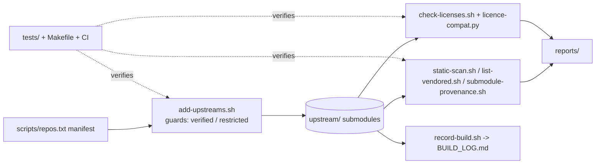

# Leonida-PC

Research workspace for the public goal **"Leonida PC"**: tracking, vetting and (later) integrating existing public Xbox-recompilation research toward a legitimate GTA VI PC implementation.

> **Status: tooling release candidate only.** No upstream project has been cloned, built or run here (GitHub was unreachable when this was prepared). **GTA VI does not boot, and nothing in this repository claims otherwise.** Upstream Leonida and ProjectReCity themselves document that the game does not boot.

## Can I play GTA VI with this?
**No, not today.** Upstream Leonida documents that the game does not boot, and this repo contains no launcher, no game files and no installer. Be wary of any "GTA VI PC" download, crack or repack: they are common malware lures. Never run one.

## How to help (3 commands, any networked machine)
```
make doctor           # checks your tools and network
make check            # runs this repo's 15 Python + 37+ shell tests
make fetch-upstream   # hardened, no-checkout clone of Leonida + identity report (SHA, submodules, LICENSE)
```
Paste `reports/upstream-identity.txt` into an issue. Full contributor path: documentation/PUBLISHING.md, CLONE_SEQUENCE.md, VERIFICATION_CHECKLIST.md. Colab: tools/colab/leonida_bringup.ipynb (untested).

## What this repository is
| Part | Path | Origin |
|---|---|---|
| Upstream projects (submodule pointers only, currently none added) | `upstream/` | third-party, own licences |
| Vetting / inventory / licence tooling, tests, CI | `scripts/`, `tests/`, `.github/`, `Makefile` | **original** (MIT, proposed) |
| Research documentation, reports, test evidence | `documentation/`, `reports/`, root `*.md` | **original** |
| Third-party licence/attribution register | `LICENSES.md`, `licenses/` | original summary of upstream terms |

No upstream code is copied here. No game files, assets or keys are or will be included.

## Architecture


## Build / test (our tooling; Python 3 stdlib + bash + git + make)
```
make check      # lint, 13 Python tests, 37 shell tests, licence report check, submodule check, secret gate
```
Upstream build instructions are in BUILD_GUIDE.md and are **not yet executed**.

## Platform matrix
| Target | Status |
|---|---|
| Our tooling on Linux x86-64 (Ubuntu 24.04, Python 3.12.3, git 2.43, GNU make 4.3, bash) | **Tested** (`reports/test-runs/`) |
| Our tooling on Windows / macOS / ARM64 | Untested |
| Any upstream project (Leonida, ReCity, Xbox2Windows, AnyPS5, ...) | Untested; documented support only, see COMPATIBILITY.md |

## Tested component matrix
| Component | Tests | Result (2026-11-23) |
|---|---|---|
| scripts: add-upstreams, gen-inventory, static-scan, check-licenses, record-commits, record-build, submodule-provenance, list-vendored | tests/test_scripts.sh (37 checks, synthetic fixtures) | 37 pass |
| licence-compat.py + manifest/licence data consistency | tests/test_licence_compat.py | pass |
| stdlib-only dependency check, CI workflow hygiene | tests/test_stdlib_only.py, tests/test_workflows.py | pass |
| CI workflows on GitHub runners | not executed (no GitHub access); the `make` targets they call were run locally | unverified on GitHub |
| Upstream builds/tests, shader/CPU translation, runtime | not run | none |

## Licences and attribution
Original files: MIT (proposed; confirm before publishing, see `LICENSE`). Upstream licences as reported, unverified: Leonida and ProjectReCity GPL-3.0-or-later; Xbox2Windows MIT; AnyPS5 GPL-2.0-only (licence-isolated); others in LICENSES.md. Percy6Stars is non-commercial and link-only. See `licenses/THIRD_PARTY.md`.

## Security and contributing
See SECURITY.md and CONTRIBUTING.md. Release notes: RELEASE_NOTES.md. Publishing steps: documentation/PUBLISHING.md.
